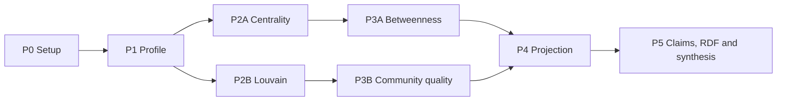
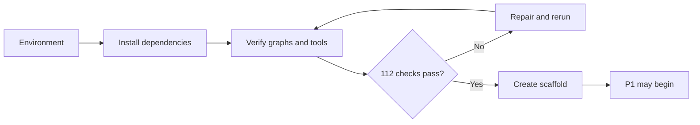
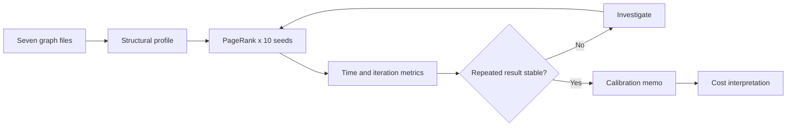
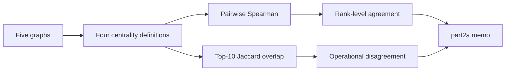
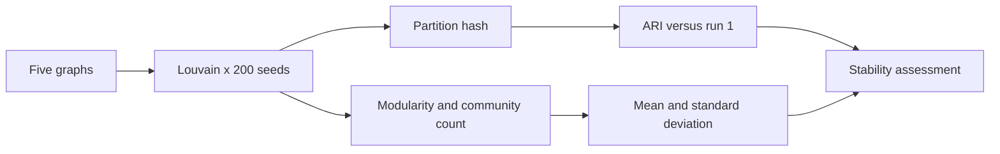
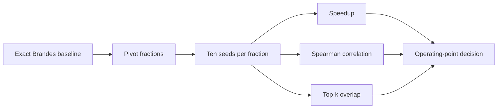
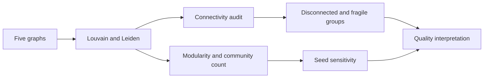
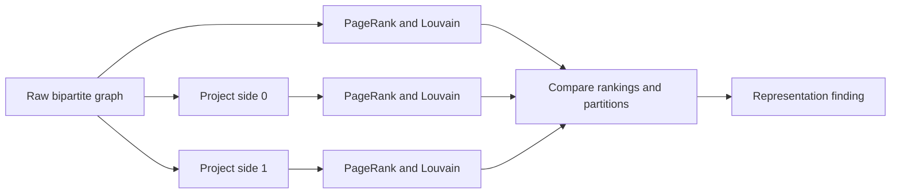
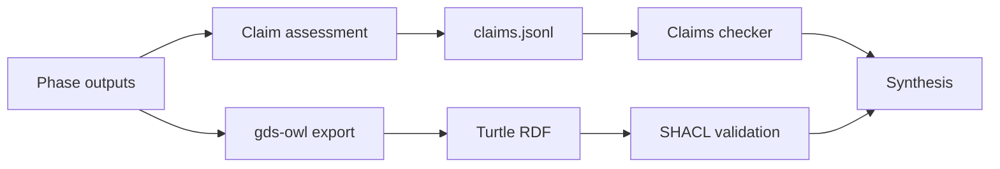

# GDS Measurement Program — Presentation Script

**Project:** `intern-gds` — Graph Data Science Measurement Program  
**Organization:** PrajnaAI  
**Presentation date:** September 2026  
**Presenter:** Solo  
**Technical companion:** `00-base/your-work/solo/gds-workflow.html`  
**Analysis companion:** `00-base/your-work/solo/graph_analysis.html`  
**Current delivery state:** P0–P4 gates pass; P5 is in progress. The claims file has 12 scaffolded rows, one draft assessment (C01), and no checker-complete claim yet.

---

## 1. Opening — the case for measurement

**Suggested time:** 2 minutes  
**Slide:** Title and one-sentence outcome.

Graph Data Science is often presented as a collection of impressive algorithms. This project takes a different position: an algorithmic result is only useful when its inputs, computational cost, stability, and interpretation are auditable.

The program treats graph analysis as a measurement discipline. We selected seven real networks with deliberately different topology, ran each experiment under recorded conditions, preserved the raw outputs, and attached provenance to the results. The objective was not to crown a universal winner. It was to establish where each method is informative, where it is fragile, and where a representation choice changes the question being answered.

The delivery has three layers:

1. **Evidence:** CSV measurements, provenance sidecars, memos, and checker reports.
2. **Interpretation:** phase memos, synthesis, claims assessment, and explicit decision rules.
3. **Communication:** `gds-workflow.html` for technical audit, `graph_analysis.html` for visual exploration, and this script for the spoken delivery.

The core experimental workload contains 1,220 repeated runs: 70 PageRank runs, 1,000 Louvain runs, and 150 sampled-betweenness runs. Centrality agreement, community-quality audits, projection comparisons, and the claims strand add further evidence beyond that core count.

**Transition line:** "Before showing the results, I want to establish what was measured and why the graph portfolio was constructed this way."

---

## 2. What this program means by GDS

**Suggested time:** 2 minutes  
**Slide:** Relationships as first-class data.

A graph is not merely a visual representation of a dataset. It is a data model in which entities and relationships are stored together. That distinction matters because the answer produced by an algorithm depends on the structure supplied to it.

This program uses six complementary views of graph behaviour:

- **Centrality** asks which nodes occupy influential or bridging positions.
- **Community detection** asks whether the network contains repeatable group structure.
- **Similarity and link prediction** ask which nodes or edges are likely to be related.
- **Paths and distances** ask how cost and reachability shape traversal.
- **Projection and reduction** ask what is retained or lost when a two-mode network is transformed.
- **Structural profiling** asks what properties of the input explain computational behaviour.

The professional value is not the production of a score in isolation. It is the ability to state the question, select a representation that matches that question, quantify uncertainty, and reproduce the answer.

---

## 3. Graph portfolio

**Suggested time:** 2 minutes  
**Slide:** Seven graphs, seven stress tests.

| ID | Graph | Nodes | Edges | Structural role |
|---|---|---:|---:|---|
| G1 | `lesmis` | 77 | 254 | Small, dense, weighted baseline |
| G2 | `unicodelang` | 868 | 1,255 | Extreme degree skew and bipartite structure |
| G3 | `crime` | 1,380 | 1,476 | Bipartite offender–crime projection test |
| G4 | `email-Eu-core` | 986 | 24,929 | Directed communication graph with department labels |
| G5 | `openflights` | 3,214 | 36,906 | Directed, weighted transportation-cost graph |
| G6 | `facebook_combined` | 4,039 | 88,234 | Large, sparse social network |
| G7 | `ca-GrQc` | 5,241 | 14,484 | Fragmented collaboration graph with many components |

The portfolio is intentionally heterogeneous. It includes directed and undirected graphs, weighted and unweighted edges, connected and fragmented networks, and two bipartite networks. This prevents a result from being mistaken for a general law after being observed on only one convenient topology.

Two interpretation rules are applied throughout:

- In `openflights`, edge weights represent travel cost, not affinity.
- A bipartite projection is a new analytical object, not a harmless simplification.

---

## 4. Program architecture

**Suggested time:** 1 minute

P0 establishes a trustworthy execution base. P1 creates the baseline. P2 splits into two independent tracks: centrality agreement and Louvain stability. P3 again splits into approximation and community-quality tracks. P4 tests the effect of changing representation. P5 converts the measured evidence into assessed claims, interoperable RDF, and a cross-phase synthesis.

Tracks A and B are parallel where their inputs are independent. The dependency chain remains strict: a failed upstream gate stops downstream interpretation rather than allowing uncertain data to propagate.

---

## 5. Phase 0 — Setup and scaffold

**Suggested time:** 1 minute  
**Aim:** Create a controlled, reproducible execution environment before any measurement is trusted.

**Objective:** Resolve the Python/scipy compatibility issue, isolate the core and semantic-web dependencies, verify all seven graph files, create the output hierarchy, and initialize the research and claims records.

**Why it matters:** A benchmark can be statistically careful and still be invalid if the runtime, package versions, or input files are uncontrolled. P0 makes the environment itself part of the evidence.

**Delivery:**

- Python 3.10.20 core environment with pinned scientific packages.
- Separate Python 3.14 environment for RDF/OWL tooling.
- `check_setup.py`: 112 of 112 checks pass.
- Seven graph inputs verified with provenance sidecars.
- `first-impressions.md`, `research-log.md`, `questions.md`, and a 12-row `claims.jsonl` scaffold.

**Speaker line:** "P0 is not administrative overhead. It is the control that makes every later number interpretable."

---

## 6. Phase 1 — Profile and calibrate

**Suggested time:** 2 minutes  
**Aim:** Establish the structural baseline and measure PageRank convergence under repeated execution.

**Objectives:**

- Record nodes, edges, density, degree distribution, components, clustering, and weight semantics for all seven graphs.
- Run PageRank ten times per graph, producing 70 observations.
- Capture compute time, iteration count, leading node, score hash, and load time.
- Compare repeated executions to distinguish portable behaviour from machine-specific timing.

**Why it matters:** Raw runtime is noisy, while iteration count and output hashes provide more stable signals. The phase asks a practical engineering question: which graph properties make an algorithm expensive, and which results are reproducible?

**Result to present:** `unicodelang` has only 868 nodes but requires 67 PageRank iterations because its degree skew is 141. `email-Eu-core` has 986 nodes but converges in 14 iterations at skew 16.5. Size alone is therefore an incomplete capacity-planning signal.

**Outputs:** `profiles.csv`, `pagerank_runs.csv`, `calibration.md`, `part1-memo.md`, and 11 PNG charts.

**Speaker line:** "The useful finding is not simply which graph is fastest. It is that topology changes the convergence contract."

---

## 7. Part 2A — Centrality agreement

**Suggested time:** 2 minutes  
**Aim:** Test whether different definitions of importance identify the same nodes.

**Objective:** Compute degree, PageRank, closeness, and betweenness on the five appropriate graphs; compare pairwise rank correlations; inspect top-10 overlap; and record named disagreements.

**Why it matters:** Centrality is not a single property. A high Spearman correlation can coexist with disagreement about the most operationally important nodes. That distinction is critical when a top-k list drives review, intervention, or resource allocation.

**Evidence to present:** The degree–PageRank correlation is high on several graphs, including 0.9935 on `email-Eu-core`, but top-10 overlap is not guaranteed. The analysis therefore reports both global rank association and local list agreement.

**Outputs:** `centrality_scores.csv`, `centrality_agreement.csv`, `centrality_cost.csv`, `disagreements.csv`, and `part2a-memo.md`.

**Speaker line:** "A correlation coefficient is a useful summary, but it is not a substitute for inspecting the nodes at the top of the ranking."

---

## 8. Part 2B — Louvain stability

**Suggested time:** 2 minutes  
**Aim:** Measure whether a heuristic community detector gives a stable answer when initialization changes.

**Objective:** Run Louvain 200 times per graph with different random seeds, recording hash, modularity, community count, elapsed time, and ARI against the first run.

**Why it matters:** A single high-modularity partition can create false confidence. Stability across seeds is a separate quality dimension and should be reported whenever a partition will be used for decisions.

**Result to present:** `crime` has modularity 0.9296 ± 0.0004 and is comparatively stable. `openflights` has modularity 0.6560 ± 0.0042 and shows materially more seed sensitivity. The result is not a binary pass/fail label; it is a measured reliability profile.

**Outputs:** `louvain_runs.csv` with 1,000 rows, `part2b-memo.md`, and two PNG charts.

**Speaker line:** "Modularity tells us how strong a partition looks; seed stability tells us whether we should trust that partition."

---

## 9. Part 3A — Betweenness approximation

**Suggested time:** 2 minutes  
**Aim:** Quantify the accuracy and cost trade-off when exact betweenness is replaced by pivot sampling.

**Objective:** Compute exact betweenness on three graphs, run sampled betweenness at 1%, 2%, 5%, 10%, and 25% with ten seeds per setting, and compare speedup, Spearman correlation, and top-k overlap.

**Why it matters:** Exact betweenness has a demanding computational profile on large graphs. Sampling is useful only when the loss of ranking fidelity is measured rather than assumed.

**Result to present:** At 1% sampling, speedup reaches roughly 96–104× while Spearman remains above 0.92, but top-10 overlap is uneven. At 5%, the observed operating point is approximately 18–20× faster with Spearman above 0.97 and materially better top-k agreement. Five percent is therefore a practical default for this workload, not a universal constant.

**Outputs:** exact and sampled betweenness CSVs, `weights_effect.csv`, two phase memos, and three PNG charts.

**Speaker line:** "The decision is not 'sample or do not sample.' It is 'which fidelity threshold is acceptable for this use case, and what does it cost?'"

---

## 10. Part 3B — Community quality

**Suggested time:** 2 minutes  
**Aim:** Evaluate community outputs beyond modularity by auditing connectivity and comparing Louvain with Leiden.

**Objective:** Run Louvain and Leiden across 50 seeds on five graphs, inspect disconnected and fragile communities, compare the algorithms, and score `email-Eu-core` against its 42 department labels.

**Why it matters:** Modularity is an internal objective, not a guarantee of meaningful or well-connected groups. Ground-truth comparison and connectivity audits expose failure modes that a single score can hide.

**Evidence to present:** The C01 draft assessment records a discrepancy with a published Louvain criticism: the measured disconnected rate is near zero in this graph set, with a maximum around 0.43%, rather than the cited 16%. The row remains a draft because its verdict vocabulary and primary-source fields still need to be normalized for the claims checker.

**Outputs:** `community_quality.csv`, `ground_truth_scores.csv`, `similarity_vs_bridges.csv`, `part3b-memo.md`, and the C01 evidence record.

**Speaker line:** "A community is not validated merely because its modularity is high. We also ask whether it is connected, stable, and aligned with the question we are actually asking."

---

## 11. Phase 4 — Bipartite projection

**Suggested time:** 2 minutes  
**Aim:** Measure how a representation change alters ranking and community conclusions.

**Objective:** Run PageRank and Louvain on the raw `crime` and `unicodelang` bipartite graphs, project each graph onto both sides, and compare raw versus projected rankings and partitions.

**Why it matters:** Projection creates edges between nodes that share a neighbour. It can introduce high-degree hubs, inflate edge counts, and change the meaning of importance. The projected graph is therefore a new question, not a transparent view of the original graph.

**Result to present:** On `crime` side 1, raw and projected PageRank have Spearman 0.002, effectively no rank association. On `unicodelang` side 0, community ARI is 0.1702, indicating little partition overlap. These are findings about representation, not implementation errors.

**Outputs:** four projection CSVs, `part4-memo.md`, `synthesis.md`, and three PNG charts.

**Speaker line:** "The most consequential modelling decision may occur before the algorithm runs: choosing the graph on which the algorithm is allowed to answer."

---

## 12. Phase 5 — Claims, RDF, and synthesis

**Suggested time:** 2 minutes  
**Aim:** Convert measured results into assessed knowledge and an interoperable archival form.

**Objectives:**

- Complete all 12 claim records with a primary source, exact supporting or contradicting quotation, evidence grade, verdict, and reasoning.
- Run the claims checker until all required fields and controlled vocabularies are valid.
- Export experimental results to Turtle RDF through `gds-owl`.
- Validate the RDF with SHACL and retain the conformance report.
- Write a synthesis that connects the phase-level findings into one decision-oriented narrative.

**Why it matters:** A benchmark becomes more valuable when another team can understand what each result claims, trace it to evidence, and query it with standard semantic-web tooling.

**Current state:** C01 has a draft rejection and supporting measurement notes, but it is not yet checker-complete because the record uses the project's draft vocabulary rather than the checker's controlled verdict values and lacks a normalized primary-source quotation. C02–C12 remain pending. `experiment.ttl` exists as an export artifact; the final SHACL conformance report and completed claims gate remain outstanding.

**Speaker line:** "Phase 5 is not a cosmetic final section. It is where the project turns measurements into claims that can be challenged, reused, and archived."

---

## 13. Claims strand

**Suggested time:** 1 minute

The claims file contains 12 records spanning community detection, retrieval, industrial deployment, construction quality, memory representation, scaling, algorithm detail, link prediction, and the conditions under which graphs help.

The assessment protocol is deliberately conservative:

1. Locate the primary source.
2. Capture a quotation long enough to preserve context.
3. Separate what the source establishes from what the project infers.
4. Assign an evidence grade.
5. Record a controlled verdict and explain any discrepancy.

The draft C01 assessment is useful evidence of the method: it compares the published claim with the project's measured disconnected-community rate. It is not yet a completed gate record. The remaining work is manual source verification, not an external dependency.

---

## 14. Bench experiments

**Suggested time:** 1 minute

The technical reference defines six follow-up benches:

- **B1:** Compare graph representations by memory use.
- **B2:** Locate the practical scale ceiling for each algorithm.
- **B3:** Test Louvain's resolution limit on planted partitions.
- **B4:** Compare random and structure-aware link-prediction splits.
- **B5:** Test the relationship between PageRank and degree on undirected graphs.
- **B6:** Determine whether weights change communities or only paths.

These benches are intentionally separated from the completed measurement phases. They are the next controlled experiments, not undocumented scope creep.

---

## 15. Quality model

**Suggested time:** 1 minute

The program uses three complementary controls:

- **Quality gates** determine whether a phase may advance.
- **Tiering** protects the minimum viable deliverable when time is constrained.
- **Decision rules** specify the response to a known anomaly before interpretation begins.

The gates are not adjustable after seeing the result. If an output fails, the output or procedure is corrected; the gate is not relaxed to make the phase appear complete.

| Gate | Control | Current state |
|---|---|---|
| G0 | Setup, 112 checks | Pass |
| G1 | Profile and PageRank | Pass |
| G2A | Centrality agreement | Pass |
| G2B | Louvain stability | Pass |
| G3A | Betweenness approximation | Pass |
| G3B | Community quality | Pass |
| G4 | Projection | Pass |
| G5 | Claims completion | In progress |

---

## 16. Chart delivery map

**Suggested time:** 1 minute  
**Slide:** Refer to `graph_analysis.html`.

The analysis page contains **19 static PNG charts** and no active Chart.js canvas charts. The Chart.js helper code is currently unused; the page's visual evidence is carried by the numbered PNG figures.

### Network graph labels

- **G1:** `lesmis`
- **G2:** `unicodelang`
- **G3:** `crime`
- **G4:** `email-Eu-core`
- **G5:** `openflights`
- **G6:** `facebook_combined`
- **G7:** `ca-GrQc`

### Chart labels

| Figure | Phase/part | Chart |
|---:|---|---|
| C01 | P1 | Compute Time vs Nodes (log-log) |
| C02 | P1 | Compute Time vs Edges (log-log) |
| C03 | P1 | Iterations vs Degree Skew |
| C04 | P1 | Iterations vs Nodes (log-log) |
| C05 | P2B | Modularity Spread |
| C06 | P2B | Disagreement by Pair |
| C07 | P3A | Approximation Quality |
| C08 | P3A | Disconnected Rate |
| C09 | P3A | Weights Cost Ratio |
| C10 | P4 | Projection Blowup |
| C11 | P4 | Score Mass by Side |
| C12 | P4 | Top-10 Survival |
| C13 | P1 | Degree distribution — `lesmis` |
| C14 | P1 | Degree distribution — `unicodelang` |
| C15 | P1 | Degree distribution — `email-Eu-core` |
| C16 | P1 | Degree distribution — `crime` |
| C17 | P1 | Degree distribution — `openflights` |
| C18 | P1 | Degree distribution — `facebook_combined` |
| C19 | P1 | Degree distribution — `ca-GrQc` |

The numbering is mirrored in `graph_analysis.html` so that a spoken reference such as "Figure C10" resolves to a specific visual without ambiguity.

---

## 17. Key findings for the close

**Suggested time:** 2 minutes

1. **Topology is a cost signal.** Degree skew explains PageRank convergence behaviour more clearly than node count alone.
2. **Heuristics need stability evidence.** Louvain's modularity can look strong while its partitions vary across seeds.
3. **Rank correlation is not top-k identity.** Centrality comparisons require both global and local agreement measures.
4. **Sampling is an operating decision.** Five-percent betweenness sampling is a strong observed trade-off for this workload, but the threshold must be revalidated for a new graph family.
5. **Representation changes conclusions.** Bipartite projection can make rankings and communities effectively unrelated to the raw graph.
6. **Ground truth and internal scores answer different questions.** Modularity, connectivity, ARI, and stability should be interpreted together.
7. **Provenance is part of the result.** Every reported number is tied to an input, execution record, and output artifact.
8. **The remaining work is explicit.** The claims strand is manual and outstanding; it is not blocked by a colleague or another machine.

---

## 18. Limitations and next actions

**Suggested time:** 1 minute

The current portfolio demonstrates methodological range, not universal statistical generalization. Exact betweenness is expensive on the largest graphs, Louvain remains heuristic, only one graph has reliable department labels, and the bipartite projections are unweighted.

The next actions are ordered by delivery value:

1. Normalize and complete all 12 claims records, beginning with C01.
2. Produce the final SHACL conformance report for the RDF export.
3. Complete the cross-phase synthesis and link it to the chart index.
4. Run the defined bench experiments where a decision requires additional evidence.
5. Expand the graph portfolio only after the current claims and interoperability gates are closed.

---

## 19. Closing

**Suggested time:** 30 seconds

This project demonstrates a repeatable way to move from graph data to defensible operational insight. The central lesson is that graph algorithms should be evaluated as a system: input representation, algorithm definition, computational cost, stability, and evidence quality all affect the conclusion.

The measurement phases are complete and gated. The remaining work is deliberately narrow: finish the claims evidence, validate the RDF export, and close the synthesis. That is the final step from a successful experiment pack to a reusable analytical asset.

---

## 20. Anticipated questions

**Why seven graphs?**  
They provide structural contrast without pretending that a small set is statistically universal.

**Why two environments?**  
The scientific-computing stack and semantic-web stack have different release and dependency constraints. Isolation prevents an upgrade in one stack from invalidating the other.

**Why is Phase 5 still open?**  
Claims verification requires human source reading and quotation-level evidence. The work is manual, but it has no external dependency.

**Can the method scale?**  
The approximation track shows a practical path for expensive betweenness computation, while the exact track defines the boundary where sampling becomes necessary.

**Why treat projection as a finding rather than a bug?**  
Because the projected graph has different nodes, edges, and implied questions. A low correlation can be the correct result of a representation change.

**What should a reviewer inspect first?**  
Start with the phase checker reports, then trace one key number through its CSV, provenance sidecar, memo, and corresponding figure.

---

## 21. Delivery references

- `00-base/your-work/solo/gds-workflow.html` — technical procedures, workflows, gates, decision rules, and deliverable manifest.
- `00-base/your-work/solo/graph_analysis.html` — numbered visual analysis and embedded measurement data.
- `00-base/your-work/solo/planner.html` — phase plan and execution controls.
- `00-base/your-work/solo/part{1,2,3,4}/` — CSVs, charts, memos, and provenance sidecars.
- `00-base/your-work/solo/claims.jsonl` — claim assessments and evidence status.